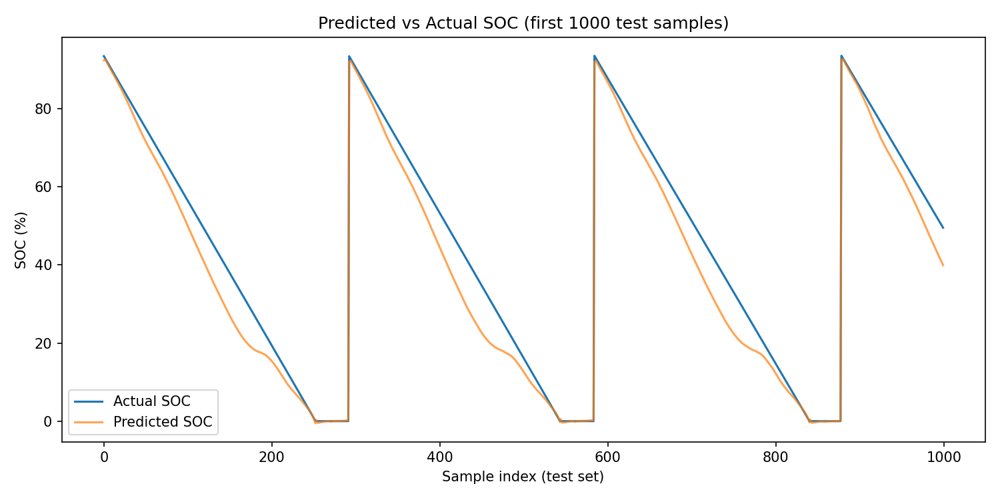

# Battery State of Charge (SOC) Estimation using LSTM

Data-driven SOC estimation for a lithium-ion battery, using an LSTM network trained on voltage, current, and temperature time series from the NASA Battery Dataset (cell B0005, 168 discharge cycles).

**Author:** Diksi Aisyah | **Contact:** aisyahdiksi@gmail.com

## Motivation

Accurate SOC estimation is a core requirement for battery management systems in Battery Energy Storage Systems (BESS), including smart grid and microgrid applications. Classical Coulomb counting drifts under sensor error and capacity fade, and model-based methods need accurate battery models. This project tests a data-driven alternative.

## Method

1. **Ground truth:** SOC labels derived by Coulomb counting from measured current and each cycle's discharge capacity (the dataset has no direct SOC labels).
2. **Preprocessing:** min-max normalization; sliding windows of 20 timesteps built within each cycle only, so no window crosses a cycle boundary.
3. **Split:** 70/30 train/test by cycle (117 train / 51 test), not by row, to prevent leakage between sets. The test set therefore contains the later, more aged cycles.
4. **Model:** single-layer LSTM (64 hidden units) plus a linear output layer, trained with Adam and MSE loss for 20 epochs.

## Results

| Model | Test RMSE | Test MAE |
|---|---|---|
| **LSTM, 1 layer, 20 epochs (final)** | **6.22%** | **4.70%** |
| LSTM, 2 layers + dropout, 40 epochs | 7.35% | 5.96% |
| Coulomb counting, fixed nominal capacity (first cycle), 0.02 A noise | 18.71% | 16.72% |
| Coulomb counting, true per-cycle capacity (near-circular, see note) | 0.12% | 0.09% |

**Observations**
- The LSTM follows the discharge trajectory and the reset at the start of each cycle.
- The main LSTM error is an underestimate during the mid-discharge plateau, where voltage changes little while SOC keeps falling.
- The deeper 2-layer model reached lower training loss but higher test error (overfitting), so the simpler model was kept.
- The cell lost 28.7% of its capacity over the dataset (1.862 Ah to 1.328 Ah). A Coulomb counter that assumes the first-cycle capacity overestimates remaining charge on aged cycles, which explains its 18.7% error. The LSTM needs neither the capacity nor the starting SOC.
- Coulomb counting with the *true* cycle capacity scores near-perfectly because the labels are computed the same way. It is shown for completeness, not as a fair competitor, since a real system does not know the true capacity.

## Limitations

- Ground truth relies on Coulomb counting and assumes each discharge ends at 0% SOC. Because labels and baseline share this method, the baseline comparison is indicative, not definitive.
- Only one cell (B0005) was used; generalization to unseen cells was not tested.
- The baseline uses simulated sensor noise, not real sensor data.
- Minimal hyperparameter tuning; no comparison against other estimators (e.g., Kalman filters).

## Repository contents

| File | Purpose |
|---|---|
| `SOC_Estimation_LSTM.ipynb` | Full pipeline in one notebook (start here) |
| `01_explore_battery_data.py` | Load and visualize the raw `.mat` data |
| `02_compute_soc.py` | Compute SOC labels via Coulomb counting |
| `03_build_windows.py` | Normalization, sliding windows, train/test split |
| `04_train_lstm.py` | Final 1-layer LSTM training and evaluation |
| `04b_train_lstm_v2.py` | 2-layer LSTM experiment |
| `05_baseline_comparison.py` | Coulomb counting baseline with true per-cycle capacity |
| `05b_baseline_comparison_v2.py` | Coulomb counting baseline with fixed nominal capacity |

## How to run

1. Download the NASA Battery Dataset: https://phm-datasets.s3.amazonaws.com/NASA/5.+Battery+Data+Set.zip (the dataset is not included in this repo).
2. Place `B0005.mat` in the same folder as the scripts.
3. Install dependencies: `pip install numpy pandas matplotlib scipy torch jupyter`
4. Run the notebook, or run the scripts in order (01 through 05b).

## Future work

Testing generalization across multiple cells, and extending the SOC estimator into a BESS simulation alongside a bidirectional DC-DC converter with closed-loop control.

## Reference

B. Saha and K. Goebel (2007). Battery Data Set, NASA Prognostics Data Repository, NASA Ames Research Center.
